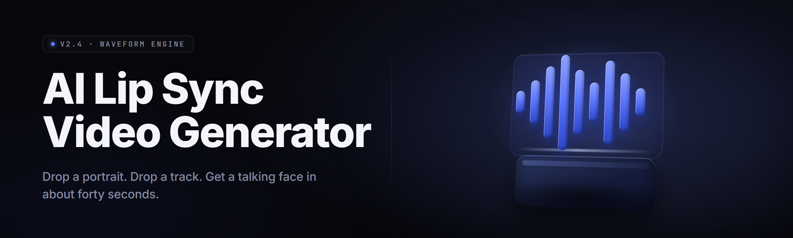

  
  
  

  

  
  

---

Open-source AI lip-sync video generator for creators — turn a portrait and an audio track into talking-head clips, local render, no subscription required.

## Overview

Open-source AI lip-sync video generator for creators — turn a portrait and an audio track into talking-head clips, local render, no subscription required.

  

## License

[MIT License](LICENSE)

  

